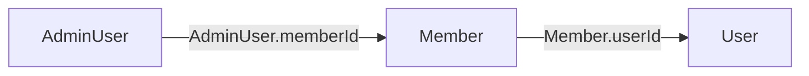
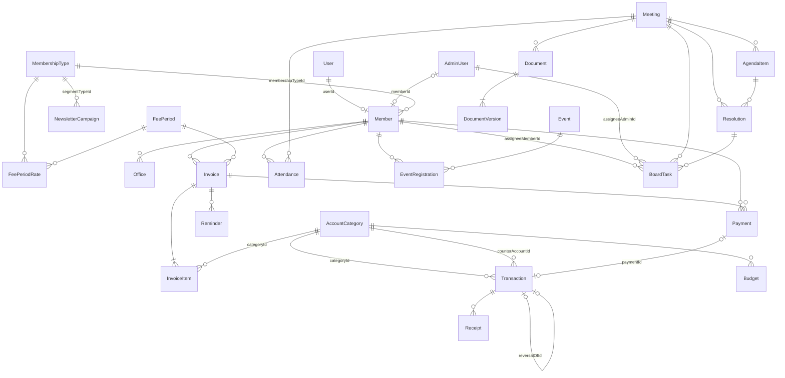

# Vereinsverwaltung: Architektur

Diese Seite beschreibt, wie die Vereinsverwaltung (ZGB Art. 60 ff.) in die bestehende Website-Software eingebaut ist. Sie richtet sich an Entwicklerinnen und Entwickler. Wo Statuten, Beträge oder Fristen betroffen sind, gilt: Der Verein trägt sie selbst ein, die Statuten gehen vor. Die Software macht keine Rechtsberatung.

## 1. Überblick

Die Software besteht aus drei Teilen, die dieselbe Datenbank und dieselbe Anmeldung nutzen:

| Teil | Wo | Wer |
| --- | --- | --- |
| Öffentliche Website | `src/app/(site)/**` | alle Besuchenden (Beitrittsformular, Anlässe, Statuten) |
| Mitgliederportal | `src/app/(site)/account/**` | angemeldete Website-Konten, mit einem Mitglied verknüpft (`/account/verein/**`) |
| Verwaltung | `src/app/admin/(panel)/**`, `src/app/api/admin/**` | Admin-Konten mit Rolle |

Bestehendes bleibt erhalten: Website, Konten, Tickets, Newsletter, Lizenzen und das Admin-Dashboard. Neu sind die Module Mitglieder, Beiträge, Kassa, Versammlungen, Anlässe, Dokumente und Aufgaben samt Vereinseinstellungen.

## 2. Mitglieder, Website-Konten und Admin-Konten

Es gibt drei getrennte Dinge, die bewusst nicht in einer Tabelle zusammenfallen:

| Begriff | Tabelle | Zweck | Anmeldung |
| --- | --- | --- | --- |
| Mitglied | `Member` | Person im Verein (Stammdaten, Status, Beitrag, Ämter) | keine eigene |
| Website-Konto | `User` | Registrierung auf der Website (E-Mail bestätigt) | Sitzung `kind = "user"` |
| Admin-Konto | `AdminUser` | Zugang zur Verwaltung mit Rolle | Sitzung `kind = "admin"` |

Verknüpfungen (alle optional, alle 1:1):



- Ein Mitglied braucht kein Konto. Wer kein Konto hat, wird per E-Mail oder Post bedient.
- `Member.userId` verbindet ein Mitglied mit seinem Website-Konto. Erst damit gibt es das Mitgliederportal. Die Verknüpfung setzt der Vorstand im Mitglieder-Detail, oder das Konto wird über die bestätigte E-Mail-Adresse zugeordnet (nur wenn `User.emailVerifiedAt` gesetzt ist, die Adresse genau mit `Member.email` übereinstimmt und das Mitglied noch kein Konto hat). Eine Verknüpfung allein aufgrund einer Angabe in der Anfrage gibt es nie.
- `AdminUser.memberId` verbindet ein Admin-Konto mit dem Mitglied, dem es gehört (Vorstandsmitglieder). Damit funktionieren Aufgaben-Zuteilung, Anzeige im Protokoll und das Mitgliederportal auch mit einer Admin-Sitzung.
- Das Amt (`Office`, z. B. Präsident) beschreibt die Funktion im Verein und die Amtszeit. Die Rolle (`AdminUser.role`) beschreibt, was jemand in der Software darf. Beides ist absichtlich getrennt: Wer gewählt ist, bekommt nicht automatisch Zugriff, und die Zugriffsrechte lassen sich ohne Wahl ändern.

### Wer ist angemeldet?

- `getCurrentAdmin()` (`src/lib/auth.ts`) liefert den Admin inklusive `roles` (alle wirksamen Rollen) und `memberId`.
- `getCurrentUser()` liefert das Website-Konto.
- `getCurrentMember()` (`src/lib/verein/guard.ts`) liefert das zur Sitzung gehörende Mitglied. Massgeblich ist nur die serverseitige Verknüpfung, nie eine ID aus der Anfrage.

## 3. Rollen und Rechte

### Rollen

`AdminUser.role` ist die Hauptrolle. `AdminUser.extraRoles` (kommagetrennt) nimmt weitere Rollen auf, wenn jemand mehrere Ämter hat, z. B. Vize-Präsident und Kassier (`role = "VIZEPRAESIDENT"`, `extraRoles = "KASSIER"`). Wirksam ist die Vereinigung aller Rollen; je Modul gilt die höchste Stufe.

Bisherige Werte (`OWNER`, `ADMIN`, `EDITOR`) bleiben gültig und behalten ihre Bedeutung. Neu: `PRAESIDENT`, `VIZEPRAESIDENT`, `KASSIER`, `AKTUAR`, `REVISOR`. Die Tokens der Sitzung enthalten nur die Hauptrolle; die Rechte werden bei jeder Anfrage aus der Datenbank gelesen, eine Änderung wirkt also sofort.

### Module und Stufen

Jede Rolle hat je Modul die Stufe `read` (lesen) oder `write` (lesen und ändern). Die Matrix steht ausschliesslich in `src/lib/verein/permissions.ts`.

| Modul | OWNER / ADMIN | Präsident | Vize | Kassier | Aktuar | Revisor | Redakteur |
| --- | --- | --- | --- | --- | --- | --- | --- |
| `dashboard` (Übersicht) | W | R | R | R | R | R | R |
| `members` | W | W | W | R | W | – | – |
| `fees` (Beiträge, Rechnungen) | W | R | R | W | – | R | – |
| `ledger` (Kassa) | W | R | R | W | – | R | – |
| `meetings` | W | W | W | R | W | R | – |
| `events` | W | W | W | R | W | – | – |
| `documents` | W | W | W | W | W | R | – |
| `tasks` | W | W | W | W | W | – | – |
| `verein_settings` | W | W | R | R | R | – | – |
| `finance_settings` (IBAN, Fristen) | W | R | R | W | – | – | – |
| `audit` (Änderungsprotokoll) | W | R | R | – | – | R | – |
| `website` (Dienste, Status, Blog, Tickets, Lizenzen, Website-Benutzer) | W | W | W | – | – | – | W |
| `newsletter` | W | W | W | – | W | – | W |
| `system` (Zugänge, Mailserver, Registrierung, Impressum) | W | R | – | – | – | – | – |
| `self` (eigenes Passwort) | W | W | W | W | W | W | W |

W = lesen und ändern, R = nur lesen. Das ist eine Voreinstellung für die übliche Aufgabenverteilung im Vorstand. Wer mehr oder weniger darf, bekommt die passende Rolle; die Statuten gehen vor.

Änderung gegenüber früher: `EDITOR` hatte bisher Zugriff auf alle Admin-Bereiche. Jetzt darf die Rolle Website-Inhalte und Newsletter bearbeiten, aber keine Systemeinstellungen (Mailserver, Registrierung, Impressum) mehr.

Vorstandsnotizen bei Mitgliedern (`Member.boardNotes`) sehen nur Rollen, für die `hasBoardRole(roles)` gilt (Inhaber, Administrator, Präsident, Vize, Kassier, Aktuar), nicht Revisor und Redakteur.

### Wie man Rechte prüft

Grundregel: Der Wächter ist die erste Anweisung jedes Handlers und jeder Seite. Layouts genügen nicht, weil sie bei der Navigation innerhalb des Bereichs nicht neu rendern. `scripts/check-admin-guards.mts` (Teil von `npm run check`) schlägt fehl, wenn eine Admin-Route oder Admin-Seite keinen Wächter enthält.

API-Route unter `/api/admin/**`:

```ts
export const GET = handle(async (req: Request) => {
  const admin = await requireAdmin(req); // Sitzung + Origin + Rolle
  ...
});
```

`requireAdmin` (`src/lib/api.ts`) leitet das Modul aus dem Pfad ab (`moduleForPath`) und die Stufe aus der Methode (GET = lesen, sonst ändern). Eine Route unter `/api/admin/ledger/**` verlangt also `ledger`. Unbekannte Pfade fallen auf `system` (nur Inhaber/Administrator): ein neuer Bereich ist erst offen, wenn er in `PATH_MODULES` eingetragen ist.

Strengere oder andere Prüfung innerhalb eines Handlers:

```ts
const admin = await requireAdminModule(req, "fees", "write"); // src/lib/verein/guard.ts
```

Ohne drittes Argument folgt die Stufe der Methode. Beispiel: Ein Zahlungseingang unter `/api/admin/members/[id]/payments` berührt `fees` und braucht `requireAdminModule(req, "fees", "write")` zusätzlich zum Pfadmodul `members`.

Server-Seite unter `/admin`:

```ts
export default async function Page() {
  const admin = await requireModulePage("members", "write"); // Stufe ist standardmässig "read"
  ...
}
```

Ohne Admin-Sitzung antwortet die Seite mit 404 (der Bereich verrät sich nicht), ohne Recht leitet sie auf `/admin/keine-berechtigung` weiter. Innerhalb der Seite blendet man Schaltflächen mit `canAccess(admin.roles, "members", "write")` aus; die Prüfung im API-Handler bleibt trotzdem Pflicht.

Mitgliederportal und Mitglieder-Endpunkte:

```ts
const { member } = await requireMember(req);        // Sitzung + verknüpftes Mitglied (jeder Status)
const { member } = await requireActiveMember(req);   // nur Status AKTIV
const member = await requireMemberPage();            // Seite: sonst Weiterleitung
```

Keine IDOR: Jede Abfrage im Portal filtert mit `memberId: member.id` (bzw. holt Datensätze über Beziehungen des Mitglieds). IDs aus der URL werden nie ohne diesen Filter verwendet. Beispiel: `db.invoice.findFirst({ where: { id, memberId: member.id } })`; liefert nichts, antwortet der Handler mit 404.

Navigation: `filterNav` blendet Einträge ohne Leserecht aus (`AdminShell`). Neue Menüpunkte tragen ihr Modul im Eintrag.

## 4. Modulgrenzen und Besitzer

Jedes Modul besitzt seine Routen, Komponenten (`src/components/admin/<modul>/**`), Zod-Schemas und Fachlogik (`src/lib/verein/<modul>-*.ts`) und ändert nur seine eigenen Prisma-Modelle. Alles andere kommt aus dem gemeinsamen Kern.

| Besitzer | Seiten und Routen | Modelle |
| --- | --- | --- |
| mitglieder | `/admin/members/**`, `/api/admin/members/**`, `/mitglied-werden`, `/account/verein/mitgliedschaft` | `Member`, `MembershipType`, `Office` |
| beitraege | `/admin/fees/**` (inkl. `/admin/fees/invoices/[id]/print`), `/api/admin/fees/**`, `/api/admin/invoices/**`, `/account/verein/beitraege` | `FeePeriod`, `FeePeriodRate`, `Invoice`, `InvoiceItem`, `Payment`, `Reminder` |
| kassa | `/admin/ledger/**`, `/api/admin/ledger/**` | `AccountCategory`, `Transaction`, `Budget`, `Receipt`, `FiscalYear` |
| versammlungen | `/admin/meetings/**`, `/api/admin/meetings/**`, `/account/verein/versammlungen` | `Meeting`, `AgendaItem`, `Attendance`, `Resolution` |
| anlaesse | `/admin/events/**`, `/api/admin/events/**`, `/anlaesse/**`, `/api/events/**`, `/account/verein/anlaesse` | `Event`, `EventRegistration` |
| dokumente-aufgaben | `/admin/documents/**`, `/admin/tasks/**`, `/api/admin/documents/**`, `/api/admin/tasks/**`, `/api/documents/**`, `/account/verein/dokumente`, `/verein/statuten` | `Document`, `DocumentVersion`, `BoardTask` |
| uebersicht-einstellungen | `/admin` (Dashboard), `/admin/verein/**` (Einstellungen, Finanzen, Zugänge, Protokoll), `/api/admin/settings/verein/**`, `/api/admin/access/**`, `/api/admin/audit/**`, `/account/verein` (Übersicht, Mitgliederausweis), Newsletter-Segmente | `AuditLog` (lesen), Einstellungen `verein.*`, `AdminUser` (Rollen), `NewsletterCampaign.segment*` |

Gemeinsamer Kern (nur über Rückfrage ändern): `prisma/schema.prisma` (Grundstruktur, `Counter`), `src/lib/verein/*`, `src/components/admin/core/*`, Navigation, `src/lib/api.ts`, `src/lib/auth.ts`.

Mitglieder-Seiten (`/account/verein/**`) liegen im gemeinsamen Rahmen `src/app/(site)/account/verein/layout.tsx` (zweite Reiterebene). Platzhalterseiten tragen im Kopf den Vermerk «Platzhalter (Besitzer: …)» und sind zu ersetzen.

## 5. Namenskonventionen

- Dateien: kleingeschrieben, Bindestriche. Routen auf Deutsch ohne Umlaute (`/anlaesse`, `/beitraege`, `/mitglied-werden`) ausser bestehenden englischen Routen (`/admin/members`, `/admin/fees`, `/admin/ledger`, `/admin/meetings`, `/admin/events`, `/admin/documents`, `/admin/tasks`).
- Bibliothek: `src/lib/verein/<modul>-<thema>.ts` für Fachlogik des Moduls (rein, ohne `server-only`, mit Test), `src/lib/verein/<modul>-data.ts` o. Ä. für Datenbankzugriff (`import "server-only"`).
- Komponenten: `src/components/admin/<modul>/…` (Verwaltung), `src/components/verein/…` (öffentlich und Portal).
- Texte: Öffentliche und Portal-Texte über `defineMessages` in `src/i18n/verein.ts` (oder eigener Datei `src/i18n/verein-<modul>.ts`). Admin-Texte dürfen direkt in den Komponenten stehen.
- Statuswerte: Grossbuchstaben ohne Umlaute (`AUSGETRETEN`, `UEBERWEISUNG`), definiert in `src/lib/verein/constants.ts` mit Bezeichnungen (`*_LABEL`) und Farben (`*_TONE`, `TONE_CLASS`). Zod-Schemas verwenden diese Listen.
- Beträge: Feldnamen enden auf `Rappen`. Datumsfelder ohne Uhrzeit enden auf `Date`/`On`/`At` je nach Bedeutung; Zeitpunkte auf `At`.
- API-Antworten: `{ data }` bzw. `{ error: { code, message, fields } }` über `adminOk`, `handle`, `ApiError` (`src/app/api/_lib/http.ts`, `src/lib/api.ts`).
- Änderungen lesen mit `parsePatch` (nur gesendete Felder), Listen mit `listParams` / `searchWhere` / `pageMeta` (`src/lib/verein/pagination.ts`).

## 6. Datenmodell



Nicht dargestellt: `AuditLog` (bewusst ohne Fremdschlüssel), `Counter` (Nummernkreise), `FiscalYear` (Abschluss je Jahr, ohne Fremdschlüssel; `Transaction.fiscalYear` ist eine Zahl), `SiteSetting` (Einstellungen).

### Konventionen im Schema

- Keine Enums: Statuswerte sind Strings (SQLite lokal, PostgreSQL produktiv). Die zulässigen Werte stehen in `constants.ts`.
- Beträge sind Integer in Rappen. Gerechnet und formatiert wird nur mit `money.ts`.
- Datum ohne Uhrzeit wird als Mittag UTC des Kalendertags gespeichert (`dateOnly`), Zeitpunkte als echte Instants. Gelesen und angezeigt wird immer in Zürcher Zeit (`dates.ts`). Eingaben `TT.MM.JJJJ HH:mm` gelten als Zürcher Zeit.
- `onDelete`: Personendaten ohne eigenen Wert (Ämter, Anwesenheiten, Anmeldungen) fallen mit dem Mitglied (`Cascade`). Buchhaltungsrelevante Datensätze (Rechnungen, Zahlungen, Buchungen, Kategorien) sind mit `Restrict` geschützt: Sie lassen sich nicht löschen, solange sie gebraucht werden. Optionale Verweise auf Sitzungen, Beschlüsse und Dokumente sind `SetNull`.
- Rechnungen halten den Empfänger als Momentaufnahme (`recipientName`, `recipientAddress`); die Rechnung bleibt gültig, auch wenn sich das Mitglied ändert oder anonymisiert wird.
- Bytes-Spalten (`Receipt.data`, `DocumentVersion.data`) nie in Listen laden: immer `select` ohne `data`.
- `Document` trägt die Metadaten, die Datei liegt in `DocumentVersion` (frühere Fassungen bleiben erhalten, `Document.currentVersion` zeigt die aktuelle).
- `EventRegistration.cancelTokenHash` ist der SHA-256 des Abmelde-Tokens; das Token selbst steht nur in der Bestätigungsmail (`createHash("sha256")`, wie `src/lib/tokens.ts`).

## 7. Fortlaufende Nummern

`src/lib/verein/ids.ts` vergibt Mitgliedernummer, Rechnungsnummer pro Jahr (`2026-0001`) und Belegnummer pro Jahr (`B-2026-0001`) über die Tabelle `Counter`. Die Vergabe ist atomar und muss in derselben Transaktion stehen, die den Datensatz anlegt, sonst entstehen bei Fehlern Lücken:

```ts
const invoice = await db.$transaction(async (tx) => {
  const { number, year, seq } = await nextInvoiceNumber(tx, yearOf(issueDate));
  return tx.invoice.create({ data: { number, year, seq, ... } });
});
```

Das Jahr der Rechnungsnummer ist das Jahr des Rechnungsdatums in Zürcher Zeit (`yearOf`).

## 8. Änderungen protokollieren (Audit)

Sensible Änderungen schreiben einen Eintrag in `AuditLog`: Mitglied angelegt, geändert, ausgetreten oder ausgeschlossen; Rolle geändert; Rechnung erstellt, storniert oder bezahlt; Buchung geändert oder korrigiert; Jahr abgeschlossen; Einstellungen geändert; Export von Mitgliederlisten.

```ts
await db.$transaction(async (tx) => {
  const after = await tx.member.update({ where: { id }, data });
  await logAudit(tx, {
    actor: auditActor(admin),
    action: "member.update",
    objectType: "Member",
    objectId: id,
    summary: `Mitglied ${after.memberNumber} geändert`,
    ...diffForAudit(before, after), // nur geänderte Felder
  });
});
```

- `logAudit` läuft mit demselben Client wie die Änderung: Innerhalb einer Transaktion wird beides zusammen gespeichert oder zurückgerollt.
- Werte werden als JSON-Text abgelegt, ohne Geheimnisse (Schlüssel mit `pass`, `secret`, `token`, `hash`, `key` werden verborgen), gekürzt und ohne Zirkelbezüge (`serializeAuditValue`).
- Aktionsnamen: `<objekt>.<verb>` (`member.create`, `member.exit`, `invoice.cancel`, `payment.create`, `transaction.reverse`, `fiscalyear.lock`, `settings.update`, `role.change`, `export.members`).
- Akteure: `auditActor(admin)`, `auditActorMember(member)`, `SYSTEM_ACTOR`.
- Das Protokoll wird nie bearbeitet oder gelöscht. Lesen dürfen es Rollen mit `audit` (`/admin/verein/protokoll`).

## 9. Gemeinsame Helfer (`src/lib/verein`)

| Datei | Inhalt |
| --- | --- |
| `permissions.ts` | Rollen, Module, Matrix, `canAccess`, `levelFor`, `effectiveRoles`, `moduleForPath`, `filterNav`, `hasBoardRole` |
| `guard.ts` | `requireAdminModule`, `requireModulePage`, `getCurrentMember`, `requireMember`, `requireActiveMember`, `requireMemberPage` |
| `money.ts` | Rappen formatieren und lesen (`1’234.50`), Rundung auf 5 Rappen, anteiliger Jahresbeitrag |
| `dates.ts` | Zürcher Zeit, Datum ohne Uhrzeit, Geschäftsjahr, Fristen, Austrittstermin, Einladungsfrist |
| `ids.ts` | fortlaufende Nummern (atomar) |
| `audit.ts` | `logAudit`, `diffObjects`, sicheres Serialisieren |
| `csv.ts` | CSV für Excel (Semikolon, BOM, CRLF), Schutz vor Formel-Injektion, `csvResponse` |
| `ics.ts` | iCalendar für Anlässe und Versammlungen, `icsResponse` |
| `files.ts` | Upload-Prüfung (Grösse, Typ am Inhalt erkannt, SHA-256), sichere Dateinamen, `downloadHeaders` |
| `iban.ts` | IBAN, QR-IBAN, QR-Referenz und Creditor Reference prüfen und bauen |
| `pagination.ts` | `listParams`, `pageMeta`, `searchWhere`, `listHref` |
| `validation.ts` | gemeinsame Zod-Bausteine (E-Mail, Betrag, Datum, Telefon, …) |
| `settings-schema.ts`, `settings.ts` | Vereinseinstellungen: Schlüssel, Zod-Schema, Lesen und Schreiben mit Protokoll |
| `links.ts` | Links für Mails und Seiten auf der festen Basis-URL |
| `mail.ts` | `sendVereinMail` im Marken-Layout, Signatur und Antwortadresse aus den Einstellungen |
| `constants.ts` | Wertelisten, Bezeichnungen, Farben |

### Sicherheitsregeln

- Jede Admin-Route und -Seite prüft serverseitig die Berechtigung (Abschnitt 3). Mitglieder-Endpunkte prüfen die Sitzung und filtern nach dem eigenen Mitglied.
- Alle Eingaben laufen durch Zod. Ausgaben ohne rohes HTML (Markdown nur über `react-markdown` wie bisher).
- Uploads: `checkUpload(file, { maxBytes, kinds })` prüft Grösse und den Inhalt (nicht den vom Browser gemeldeten Typ). Grenzen: Belege 5 MB (`RECEIPT_MAX_BYTES`), Dokumente 10 MB (`DOCUMENT_MAX_BYTES`). Downloads immer mit `downloadHeaders` (Anhang, `nosniff`, kein öffentliches Caching).
- CSV: Alle Textzellen laufen durch `csvField`; Zellen, die mit `=`, `+`, `-`, `@`, Tabulator oder Wagenrücklauf beginnen, werden mit `'` neutralisiert. Zahlen nur über `csvNumber`/`csvMoney`.
- Mails: Links ausschliesslich über `links.ts` (`SITE_URL` bzw. Vereinsdomain), nie aus dem Host-Header. Empfängeradressen vorher mit `emailSchema` prüfen.
- Datenschutz (revDSG): nur erheben, was der Verein braucht (Geburtsdatum ist optional); Mitgliederlisten und Exporte nur für Rollen mit Leserecht auf `members`; sensible Änderungen und Exporte in `AuditLog`.

## 10. Vereinseinstellungen

Die Einstellungen liegen in `SiteSetting` (Schlüssel/Wert), Schlüssel mit Präfix `verein.`. Schema, Voreinstellungen und Vollständigkeitsprüfung: `settings-schema.ts`; Lesen und Schreiben (mit Protokolleintrag): `settings.ts` (`getVereinSettings`, `saveVereinSettings`).

| Feld | Schlüssel | Voreinstellung |
| --- | --- | --- |
| `accountHolder` | `verein.account.holder` | leer |
| `iban` | `verein.account.iban` | leer (gültige Schweizer IBAN, keine QR-IBAN) |
| `qrIban` | `verein.account.qrIban` | leer (QR-IBAN, Institutskennung 30000–31999) |
| `bank` | `verein.account.bank` | leer |
| `paymentDays` | `verein.fees.paymentDays` | nicht festgelegt |
| `reminderAfterDays` | `verein.fees.reminderAfterDays` | nicht festgelegt |
| `reminderDays1`, `reminderDays2`, `reminderDays3` | `verein.fees.reminderDays1` … `3` | nicht festgelegt |
| `reminderFee1Rappen` … `3` | `verein.fees.reminderFee1Rappen` … `3` | nicht festgelegt (= 0) |
| `fiscalStartMonth`, `fiscalStartDay` | `verein.fiscal.startMonth`, `verein.fiscal.startDay` | 1 / 1 (Kalenderjahr, gemäss Statuten anpassen) |
| `invitationDays` | `verein.assembly.invitationDays` | nicht festgelegt (Einladungsfrist gemäss Statuten) |
| `exitMode` | `verein.exit.mode` | `KALENDERJAHR` |
| `exitNoticeMonths` | `verein.exit.noticeMonths` | 6 |
| `senderName`, `senderSignature` | `verein.texts.senderName`, `verein.texts.signature` | leer |
| `invoiceMailIntro`, `reminderMailIntro`, `invitationMailIntro`, `welcomeMailText` | `verein.texts.*` | leer (die Module bringen neutrale Standardtexte mit) |
| `replyToEmail` | `verein.mail.replyTo` | leer |
| `applyEnabled` | `verein.public.applyEnabled` | `false` (Beitrittsformular aus) |
| `applyNotifyEmail` | `verein.public.applyNotifyEmail` | leer |

Die Vereinsstammdaten liegen getrennt davon unter eigenen Schlüsseln (`src/lib/verein/profile-schema.ts`, Lesen und Schreiben in `profile.ts`, mit Protokolleintrag):

| Feld | Schlüssel | Voreinstellung |
| --- | --- | --- |
| `name` | `verein.profile.name` | Rechtsträger der Website (`src/lib/sites.ts`) |
| `seat` | `verein.profile.seat` | leer (Sitz gemäss Statuten) |
| `foundedOn` | `verein.profile.foundedOn` | leer |
| `purpose` | `verein.profile.purpose` | leer (Zweck gemäss Statuten) |
| `uid` | `verein.profile.uid` | leer (UID mit Prüfziffer geprüft) |
| `register` | `verein.profile.register` | leer |

Wer den Vereinsnamen braucht (Mails, Impressum, Dokumente), nutzt `getVereinName()` aus `profile.ts`.

Keine erfundenen Werte: Beträge, Fristen und Kontodaten sind leer, bis der Verein sie einträgt. Fehlt etwas, das eine Funktion braucht, meldet `missingForInvoicing`, `missingForReminders` bzw. `missingForInvitations` genau, was fehlt. Die Funktion bleibt bis dahin gesperrt, mit Hinweis und Link auf `/admin/verein/finanzen` bzw. `/admin/verein`.

Zwei Voreinstellungen haben eine Grundlage im Gesetz bzw. sind neutral und sind in der Oberfläche mit «gemäss Statuten anpassen» zu kennzeichnen:

- Austritt: ZGB Art. 70 Abs. 2 sieht, wenn die Statuten nichts anderes bestimmen, den Austritt nur auf Ende eines Kalenderjahres vor, mit Ankündigung spätestens sechs Monate vorher. `earliestExitDate(eingang, exitRuleOf(settings), fiscalStartOf(settings))` berechnet den frühestmöglichen Termin.
- Stimmrecht: ZGB Art. 67 gibt allen Mitgliedern das gleiche Stimmrecht, sofern die Statuten nichts anderes bestimmen. Die Mitgliedschaftsarten werden entsprechend mit Stimmrecht angelegt.

Die Mitgliedschaftsarten «Aktivmitglied» und «Passivmitglied» legt der Seed als Vorlagen an, mit Beitrag 0 CHF und dem Hinweis, dass der Verein Beitrag und Rechte festlegt.

## 11. Datenschutz und Aufbewahrung

- Zweckbindung und Datensparsamkeit: Pflichtangaben sind Name und eine Kontaktmöglichkeit. Adresse, Telefon und Geburtsdatum sind optional bzw. nur, wenn der Verein sie braucht. Mit dem Beitrittsantrag bestätigen Personen Statuten und Datenschutzhinweis (`Member.consentAt`).
- Zugriff: Mitgliederlisten, Exporte und Vorstandsnotizen nur für berechtigte Rollen. Mitglieder sehen im Portal ausschliesslich ihre eigenen Daten.
- Protokoll: Sensible Änderungen stehen im `AuditLog` (Abschnitt 8). Das Protokoll enthält keine Passwörter oder Tokens.
- Buchhaltungsunterlagen (Rechnungen, Zahlungen, Buchungen, Belege): Aufbewahrung 10 Jahre als Voreinstellung der Software. Sie dürfen in dieser Zeit nicht gelöscht werden (`Restrict`). Die Rechnung enthält dafür den Empfänger als Momentaufnahme. Massgeblich sind die Vorgaben, die für den Verein gelten; im Zweifel klärt der Verein sie mit seiner Revisionsstelle oder Treuhand ab.
- Mitgliederdaten nach Austritt: nur noch soweit nötig, also für offene Forderungen, Buchhaltungsbelege, Protokolle und das Mitgliederverzeichnis der Vereinsgeschichte. Darüber hinaus entfernt der Vorstand Personendaten (Kontaktdaten, Geburtsdatum, Notizen) und setzt `Member.anonymizedAt`; Mitgliedernummer, Status, Eintritts- und Austrittsdatum bleiben. Das Modul Mitglieder bietet dafür die Aktion «Personendaten entfernen» an, die nur ohne offene Forderungen möglich ist und im Protokoll steht.
- Löschbegehren (revDSG): werden über dieselbe Aktion umgesetzt, soweit keine gesetzliche Aufbewahrung entgegensteht.
- Anmeldungen von Gästen zu Anlässen: Name und E-Mail nur für den Anlass; nach dem Anlass entfernen oder anonymisieren.
- Newsletter: bleibt Double-Opt-In. Segmente nach Mitgliedschaftsart gleichen Abonnenten über die E-Mail-Adresse mit aktiven Mitgliedern ab; ein Mitglied ohne Newsletter-Anmeldung erhält keinen Newsletter. Vereinsmitteilungen (Einladung, Rechnung, Mahnung) sind Mitteilungen im Rahmen der Mitgliedschaft und laufen über `sendVereinMail`.

## 12. Prüfen

- `npm run typecheck`, `npm run lint` (ohne Warnungen)
- `npm run test` enthält `scripts/test/verein-core.test.mts` (Geld, Datum, Fristen, CSV, Audit, Rechte, Nummern, IBAN, ICS, Uploads, Einstellungen)
- `npx tsx scripts/check-admin-guards.mts` prüft die Wächter (Teil von `npm run check`)
- Datenbank lokal: `DATABASE_URL="file:./dev.db" flock /tmp/prisma.lock npx prisma db push --skip-generate && flock /tmp/prisma.lock npx prisma generate`

Reine Fachlogik gehört in eigene Dateien ohne Seiteneffekte mit einem Test unter `scripts/test/` (Muster: `verein-core.test.mts`), eingehängt in `npm run test`.
